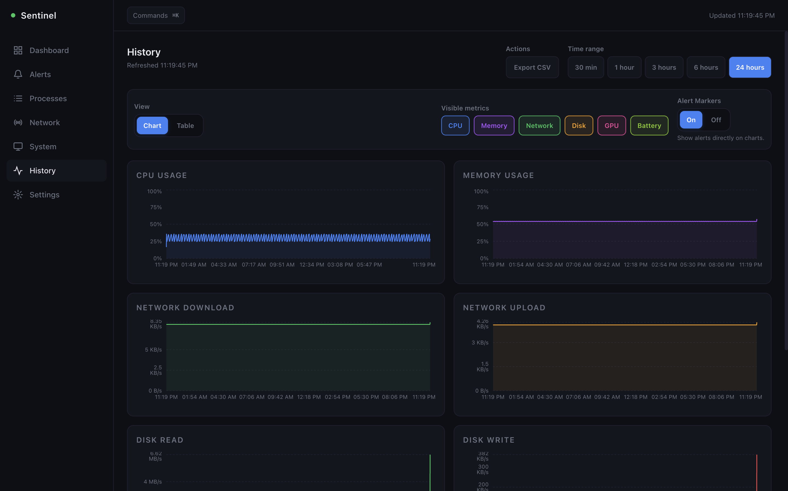

<p align="center"></p>

# Sentinel

Sentinel is a free, MIT-licensed desktop system monitor. It shows what your computer is doing now and keeps a local history. It does not require an account, a server, or telemetry.


## Download and Compatibility

Sentinel is distributed as source code. No public installers are provided. See [GitHub Releases](https://github.com/Drippyz1/sentinel/releases) for published versions and [build from source](#build-from-source) for installation instructions. GitHub's generated source archives are not executable applications.

| Platform | Package targets                         | Validation                                                          |
| -------- | --------------------------------------- | ------------------------------------------------------------------- |
| macOS    | DMG or ZIP (arm64, x64)                 | Apple Silicon desktop and local package tested; Intel unverified    |
| Windows  | NSIS installer (x64, arm64)             | Native desktop and installer validation pending                     |
| Linux    | AppImage or Debian package (x64, arm64) | ARM64 container packaging tested; native desktop validation pending |

Publicly trusted macOS and Windows installers are not currently available. Local macOS packages are ad-hoc signed and intended for development, not public distribution. The app does not install updates automatically. See the [release guide](docs/release.md) for packaging requirements.

## Features

- **Dashboard:** CPU load and temperature, memory and swap, disk capacity and activity, network throughput, GPU, and battery. Reorder widgets, change density, or pause live updates without interrupting recording.
- **Processes and connections:** Inspect and filter running processes and TCP/UDP connections. Terminate a process with native confirmation where your OS permits it.
- **System:** Inspect hardware and OS information, export reports, and view thermal information and read-only LaunchAgent and LaunchDaemon configuration on macOS. Sentinel's own Launch at Login setting is separate.
- **History and alerts:** Keep local metric and alert history, review chart markers and tables, export CSV, and configure thresholds, notifications, polling, and retention.
- **Desktop:** Use the tray popover or the floating Mini Monitor for a compact view.

Sensors, process details, and battery data depend on the hardware, OS, and user permissions. Windows disk throughput is not currently collected. Sentinel does not request elevation or install privileged helpers. macOS `Available` estimates reclaimable APFS space when supported; `Free now` is immediately free. See [monitoring architecture](docs/core-monitoring.md) for units, data sources, and limitations.



## Build from Source

Use Node.js 24 and npm (local verification used Node.js 24.22.2 and npm 11.19.1). Build packages on the target OS and architecture because SQLite uses a native binding. If a prebuilt binding is unavailable, install that platform's native build toolchain.

```sh
git clone https://github.com/Drippyz1/sentinel.git
cd sentinel
npm ci
npm run build
npm start -- --skipBuild
```

Run `npm run verify` for lint, regression tests, TypeScript, build, and release metadata. After the build, `npm run smoke:desktop` opens an isolated test profile, leaving your history and settings alone. Use `npm run dist:mac:dev`, `npm run build:win`, or `npm run build:linux` to create local packages in `dist/`. See the [release guide](docs/release.md) for artifact verification and release requirements.

## Privacy and Support

Settings, history, alerts, and hardware readings remain in the local application profile. Sentinel does not look up remote endpoints through external DNS. Diagnostic ZIPs omit direct identifiers such as hostnames, IP addresses, and volume labels; app names, hardware details, and settings can still identify a device. Review all exports before sharing.

Report bugs or request features on [GitHub Issues](https://github.com/Drippyz1/sentinel/issues). Read the [contribution guide](.github/CONTRIBUTING.md) and use the [security policy](.github/SECURITY.md) for private reports.

## Development and Roadmap

Sentinel Desktop is the current application. Native Windows and Linux verification, performance budgets, and distribution remain priorities. A lightweight Sentinel Agent and optional self-hosted Sentinel Hub are planned; their implementation technologies and architecture remain under evaluation. Remote monitoring is not currently available.

- [Milestones](https://github.com/Drippyz1/sentinel/milestones)
- [Community discussions](https://github.com/Drippyz1/sentinel/discussions)
- [Verification methods and platform limitations](docs/verification.md)

## License

[MIT](LICENSE). Electron and bundled dependencies carry their own notices.
