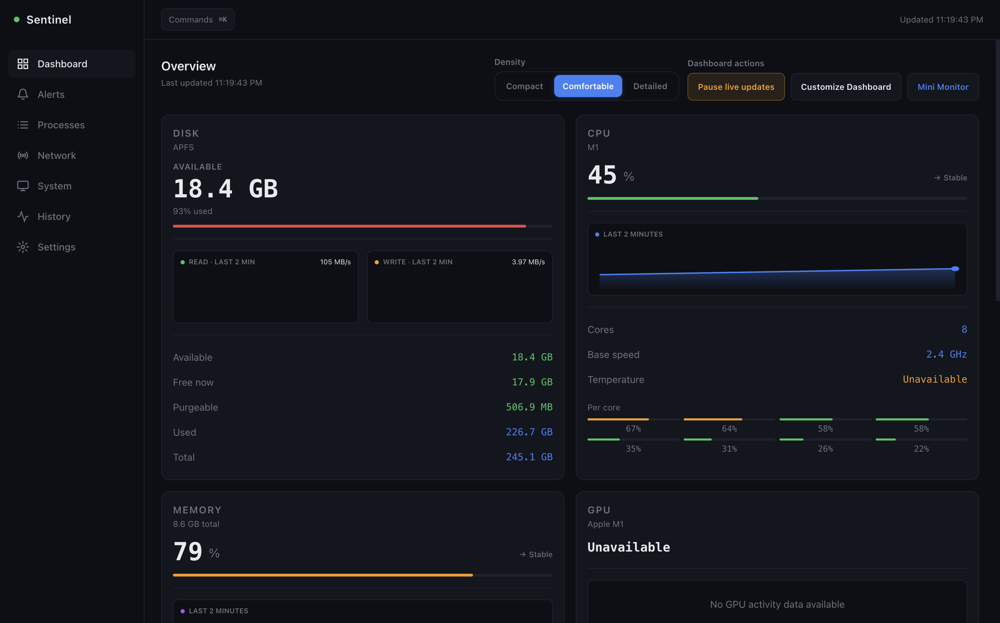

<p align="center"></p>

# Sentinel

Sentinel is a free, MIT-licensed desktop system monitor. It shows what your computer is doing now and keeps a local history. It does not require an account, a server, or telemetry.



## Download and Compatibility

Sentinel is distributed as source code. No public installers are provided. See [GitHub Releases](https://github.com/Drippyz1/sentinel/releases) for published versions and [build from source](#build-from-source) for installation instructions. GitHub's generated source archives are not executable applications.

| Platform | Package targets                         | Validation                                                         |
| -------- | --------------------------------------- | ------------------------------------------------------------------ |
| macOS    | DMG or ZIP (arm64, x64)                 | Apple Silicon source launch and local app tested; Intel unverified |
| Windows  | NSIS installer (x64, arm64)             | Native desktop and installer validation pending                    |
| Linux    | AppImage or Debian package (x64, arm64) | Native desktop and installer validation pending                    |

Publicly trusted macOS and Windows installers are not currently available. Local macOS packages are ad-hoc signed and intended for development, not public distribution. The app does not install updates automatically. See the [release guide](docs/release.md) for packaging requirements.

## Features

- **Dashboard:** CPU load and temperature, memory and swap, disk capacity and activity, network throughput, GPU, and battery. Change the layout and density, or pause live updates without interrupting recording.
- **Processes and connections:** Live Processes shows up to 100 entries ranked by CPU. Browse searches the latest collected inventory, capped at 4,096, with separate reported and captured counts. Inspect local TCP/UDP connections and terminate an individual process with native confirmation and identity checks where permitted.
- **System:** Inspect hardware and OS information, export reports, and view thermal information and read-only LaunchAgent and LaunchDaemon configuration on macOS. Sentinel's own Launch at Login setting is separate.
- **History and alerts:** Keep local metric and alert history, review chart markers and tables, export CSV, and configure thresholds, notifications, polling, and retention.
- **Storage Explorer:** Inspect metadata in an explicitly selected folder or volume. Explore logical and allocated estimates with Radial and Treemap views, search, and category breakdown. [Storage Explorer guide](docs/storage-explorer.md).
- **Duplicate Files and Similar Photos:** After separately authorizing a folder, verify exact copies or compare similar JPEG and PNG images. Analysis is local, read-only and limited to supported macOS and Linux filesystems. [Duplicate Files guide](docs/duplicate-files.md).
- **Desktop:** Customize dashboard widgets, themes and appearance profiles. Use the tray popover or floating Mini Monitor for a compact view. See [desktop personalization](docs/desktop-personalization.md).

Sensors, process details, and battery data depend on the hardware, OS, and user permissions. Windows disk throughput is not currently collected. Sentinel does not request elevation or install privileged helpers. macOS `Available` estimates reclaimable APFS space when supported; `Free now` is immediately free. See [monitoring architecture](docs/core-monitoring.md) for units, data sources, and limitations.


## Build from Source

Use native Node.js 24 LTS and its npm. This installation was tested on Apple Silicon with Node.js 24.22.2 and npm 11.19.1. On macOS, have Xcode Command Line Tools and Python 3 available for the native SQLite build. Run the commands from the extracted release source or a checkout of the release revision:

```sh
npm ci
npm run build
npm start -- --skipBuild
```

`npm ci` runs the locked Electron runtime installer and rebuilds SQLite for Electron. It requires network access to the npm registry, Electron's GitHub release downloads, and native build headers. See [installation troubleshooting and upgrades](docs/install.md) for script policies, runtime failures, and how to preserve your profile.

Run `npm run verify` for lint, regression tests, TypeScript, build, and release metadata. After the build, `npm run smoke:desktop` opens an isolated test profile. For local packages and public signing requirements, see the [release guide](docs/release.md).

## Privacy and Support

Settings, history, alerts, and hardware readings remain in the local application profile. Sentinel does not look up remote endpoints through external DNS. Diagnostic ZIPs omit direct identifiers such as hostnames, IP addresses, and volume labels; app names, hardware details, and settings can still identify a device. Review all exports before sharing.

Report bugs or request features on [GitHub Issues](https://github.com/Drippyz1/sentinel/issues). Read the [contribution guide](.github/CONTRIBUTING.md) and use the [security policy](.github/SECURITY.md) for private reports.

## Development and Roadmap

Sentinel Desktop is the current application. Native Windows and Linux verification, long-running performance, and larger analysis workloads are future work. Sentinel Agent, Sentinel Hub, remote monitoring, and file cleanup are not part of this release.

- [Milestones](https://github.com/Drippyz1/sentinel/milestones)
- [Community discussions](https://github.com/Drippyz1/sentinel/discussions)
- [Verification methods and platform limitations](docs/verification.md)
- [Desktop settings, History, and IPC behavior](docs/desktop-reliability.md)

## License

[MIT](LICENSE). Electron and bundled dependencies carry their own notices.
