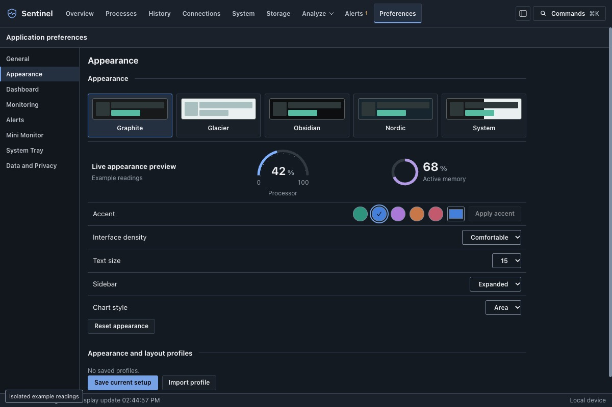
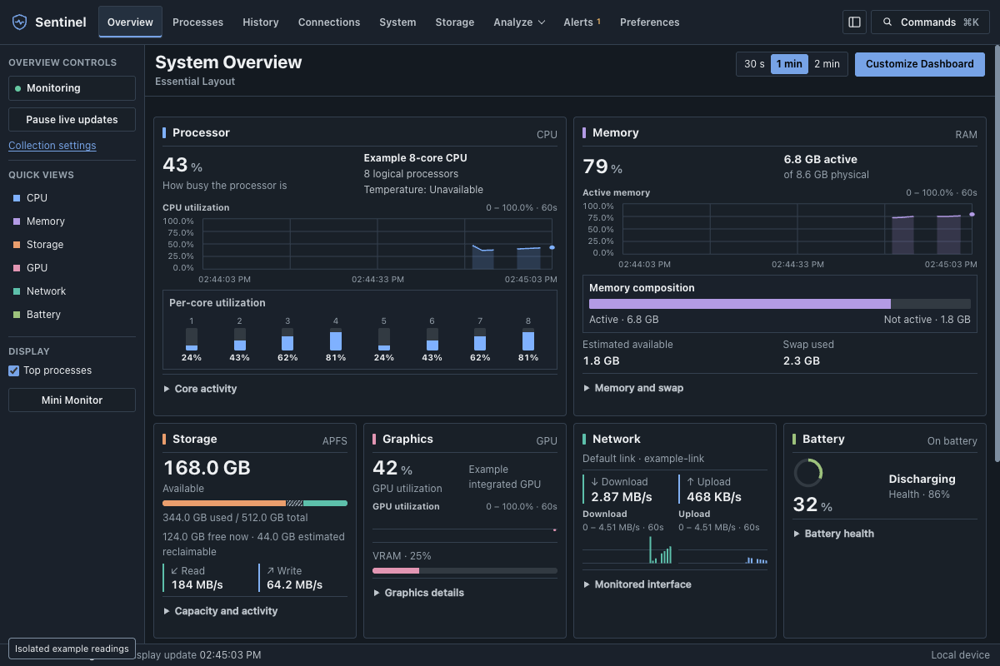

# Desktop personalization

Sentinel ships with Graphite (default), Glacier, Obsidian and Nordic. System follows macOS, Windows or Linux's reported light/dark preference and resolves to Glacier or Graphite. Appearance applies to every Sentinel window without restarting collection. Accent colors are adjusted for legibility against the chosen theme; semantic warning and error colors stay independent.

## Overview layouts

Open **Customize Dashboard** to preview a preset, set density, and choose which widgets and charts to show. Drag a widget handle onto another widget or use its move-up and move-down buttons. Set standard, wide, or full width; Summary keeps details available on demand, and Expanded opens those details by default. Widget styles are limited to the instruments that can represent that metric meaningfully. Save layout commits the whole draft once; Cancel discards it. At narrow widths, wide widgets use the available grid width without changing keyboard order. Reset layout restores Essential without changing appearance.

Existing dashboard ordering, visibility, and width preferences are kept. Legacy customized layouts become Custom. Missing IDs are appended in canonical order. Values and chart preferences belong to the view, not the collector: hiding a widget or pausing display doesn't stop history and alert processing. Live timelines use collector observation timestamps and break at unavailable readings, pauses, and interrupted streams.

The Memory widget reports active memory as a share of physical RAM, not memory pressure. Disk Available can include estimated reclaimable APFS space; Free now is the immediately free reading. History leaves gaps for missing recorded observations and keeps legacy CSV units distinct.

## Appearance Profiles

Under **Preferences > Appearance**, save the current appearance and dashboard as a named profile. Apply, rename, export or remove it from the same list. Import opens a native file picker. Review the profile and save it before applying it. Reset appearance does not reset layout or remove saved profiles.

Profile version 1 is a JSON object containing exactly `version`, `name`, `appearance`, and `dashboard`. The profile name is 1 to 48 characters; a profile file may not exceed 16 KiB. Sentinel stores up to 12 profiles per local profile, with unique names ignoring case.

| Object       | Allowed contents                                                                                                                                                                                                                                                  |
| ------------ | ----------------------------------------------------------------------------------------------------------------------------------------------------------------------------------------------------------------------------------------------------------------- |
| `appearance` | Theme, six-digit hex accent, density, 14/15/16 px text size, sidebar mode, known startup page and area/line chart style                                                                                                                                           |
| `dashboard`  | Widget density, visibility for all known stable widget IDs, complete ID order, and `dashboardLayout` with preset, legacy wide IDs, hidden-chart IDs, and an optional `presentation` map of known widget IDs to a bounded width, height, and metric-specific style |

The file cannot contain code, URLs, monitoring or OS settings, data or additional fields. Import validates before changing preferences. Export saves only a new file at a user-selected destination and never replaces an existing file. File previews do not change the running theme; saves use the same revisioned transaction path as other preferences.

Profiles from the earlier 1.5C design still load. Builds that predate the optional `presentation` map reject a profile that uses it rather than apply an incomplete layout.

## Desktop Behavior

Mini Monitor's size, grid/list display and selected readings are configurable. The metric region scrolls independently of the header and footer. Opacity is available on macOS and Windows; Windows runtime behavior has not been verified. Mini Monitor can still be hidden during a settings write failure; its startup preference will remain unchanged until a save succeeds.

The tray controls tray-popover metrics and compactness, not native menu-bar metric text. Auxiliary windows receive their permitted settings and theme, not saved profiles or main window layout. See the [IPC capability matrix](ipc-capabilities.md).

Use Command+K on macOS or Ctrl+K elsewhere to open the command palette. Modal views keep focus inside, close with Escape when dismissible, and return focus to the opener when available. The interface respects the OS reduced-motion preference. These checks do not constitute accessibility certification.

For local verification after building, run `npm run smoke:desktop` and `node_modules/.bin/electron scripts/accept-desktop-design.cjs`. Both create isolated application profiles. The design fixture substitutes example device details and processes for screenshot privacy; the ordinary smoke test verifies live collection.
